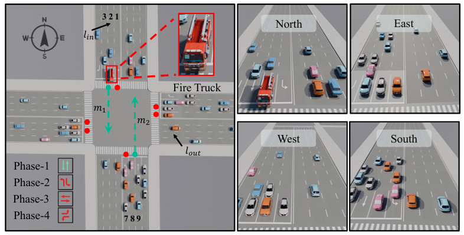
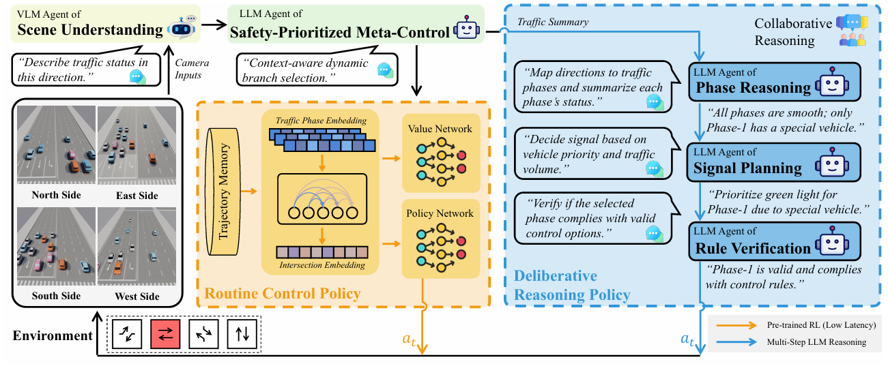
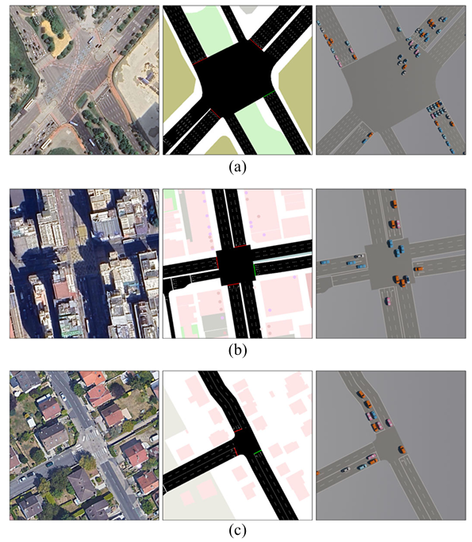
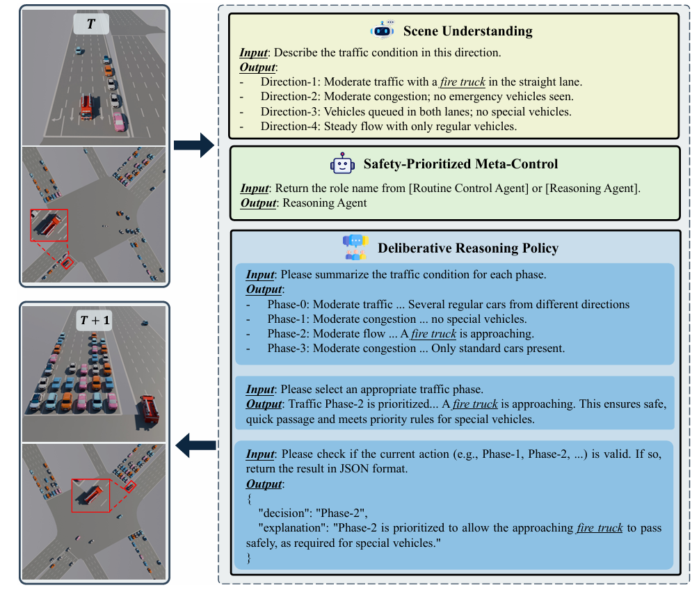

<!--
 * @Author: WANG Maonan
 * @Date: 2025-12-15 12:11:53
 * @Description: VLMLight: Safety-Critical Traffic Signal Control via Vision-Language Meta-Control and Dual-Branch Reasoning Architecture
 * @LastEditTime: 2025-12-15 15:11:53
-->
# VLMLight: Safety-Critical Traffic Signal Control via Vision-Language Meta-Control and Dual-Branch Reasoning Architecture

- [VLMLight: Safety-Critical Traffic Signal Control via Vision-Language Meta-Control and Dual-Branch Reasoning Architecture](#vlmlight-safety-critical-traffic-signal-control-via-vision-language-meta-control-and-dual-branch-reasoning-architecture)
  - [Introduction](#introduction)
    - [研究背景](#研究背景)
    - [现有的方法及存在的问题](#现有的方法及存在的问题)
    - [本文的创新点](#本文的创新点)
  - [Method: VLMLight](#method-vlmlight)
    - [场景理解 (Scene Understanding via VLM)](#场景理解-scene-understanding-via-vlm)
    - [安全优先的元控制 (Safety-Prioritized Meta-Control)](#安全优先的元控制-safety-prioritized-meta-control)
    - [常规控制策略 (Routine Control Policy - RL)](#常规控制策略-routine-control-policy---rl)
    - [深思熟虑的推理策略 (Deliberative Reasoning Policy - LLM)](#深思熟虑的推理策略-deliberative-reasoning-policy---llm)
  - [Results](#results)
    - [实验设置 (Experimental Setup)](#实验设置-experimental-setup)
    - [常规与紧急场景下的性能 (Performance under Routine and Safety-Critical Scenarios)](#常规与紧急场景下的性能-performance-under-routine-and-safety-critical-scenarios)

## Introduction

### 研究背景

城市交通拥堵导致了巨大的经济损失和环境破坏，交通信号控制（TSC）在调节交通流中起着至关重要的作用。高效的信号控制需要在复杂的动态环境中平衡通行效率与公共安全（例如让行紧急车辆）。

### 现有的方法及存在的问题

目前的TSC方法主要分为三类，各自存在明显的局限性：

- **基于规则的方法（Rule-based）：** 如 Webster 和 MaxPressure，依赖预定义规则，无法应对现代路网的动态性和非平稳性。
- **强化学习方法（RL-based）：** 虽然在常规场景下表现出色，但依赖简化的向量化状态（如排队长度），缺乏语义丰富的视觉线索。在涉及救护车通行等安全关键（Safety-Critical）场景时，仅以吞吐量为目标的 RL 代理往往难以做出符合现实世界优先级的决策。
- **大语言模型方法（LLM-based）：** 虽然具备高层推理能力，但主要依赖文本描述，缺乏真实的视觉接地（Visual Grounding），且多步推理导致的高延迟使其难以满足实时控制的需求。此外，现有的模拟器（如SUMO）通常无法提供实时图像输入，限制了视觉-语言融合的研究。

### 本文的创新点

为了解决上述问题，作者提出了 **VLMLight** 框架：

1. **首个支持多视角的视觉TSC模拟器：** 开发了基于图像的交通模拟器，支持路口的多视角视觉输入，使策略能够推理车辆类型、运动模式和空间密度等丰富视觉线索。下图展示了仿真器的效果。
2. **双分支推理架构（Dual-Branch Reasoning）：** 引入了一个以安全为优先的Meta-Controller（元控制器），根据实时路况动态选择控制模式：
    - **常规交通：** 使用快速响应的RL策略。
    - **关键场景：** 激活基于LLM的深思熟虑推理分支（Deliberative Reasoning），处理紧急车辆优先通行等复杂任务。
3. **显著的性能提升：** 实验表明，该方法在保持常规交通效率（性能下降\<1%）的同时，将紧急车辆的等待时间减少了高达 65%。

    

## Method: VLMLight

VLMLight 的核心思想是将感知、推理和控制过程自然语言化，并根据场景复杂度分流控制权。架构主要包含四个阶段，如下图所示：

    

### 场景理解 (Scene Understanding via VLM)

- 利用 **VLM (Vision-Language Model)** 作为 $Agent_{Scene}$，处理来自路口多个方向的图像输入 $\{I_1, I_2, ..., I_D\}$。
- 生成结构化的自然语言描述 $T_i$，包含车道语义、拥堵程度以及是否有特殊车辆（如救护车）。这是后续决策的感知基础。

### 安全优先的元控制 (Safety-Prioritized Meta-Control)

- 引入 **Meta-Controller** ($Agent_{ModeSelector}$)，这是一个轻量级的 LLM 代理。
- 它分析场景描述 $T_i$，决定控制权归属：
    - 若场景符合 RL 训练分布（常规拥堵），选择 **RL分支** 以保证低延迟。
    - 若检测到关键元素（如紧急车辆、事故），激活 **LLM推理分支**。

### 常规控制策略 (Routine Control Policy - RL)

- 设计用于低延迟、高吞吐量的场景。
- 使用 Transformer 编码器处理时空特征（Spatio-temporal features），输入为过去的交通状态张量 $S_t$。
- 使用 **PPO (Proximal Policy Optimization)** 算法训练，奖励函数旨在最小化路口拥堵和延迟。

### 深思熟虑的推理策略 (Deliberative Reasoning Policy - LLM)

当进入该分支时，多个LLM代理通过结构化对话进行协作：
- $Agent_{Phase}$ **(Phase Reasoning):** 将分方向的场景描述 $T_i$ 转换为基于相位的交通摘要 $P_i$（例如：结合直行车道描述形成“相位1”的状态）。
- $Agent_{Plan}$ **(Signal Planning):** 根据控制目标（如优先通过救护车）评估候选相位，选择最佳动作 $a_t^{LLM}$ 并生成解释。
- $Agent_{Check}$ **(Rule Verification):** 验证选定动作是否符合当前的合法相位集合 $\mathcal{A}$，确保安全性。

## Results

### 实验设置 (Experimental Setup)

- **模拟环境：** 基于 SUMO 二次开发的视觉 TSC 模拟器，支持多视角图像渲染。
- **数据集：** 选取了三个具有不同拓扑结构的真实路口，如下图所示，其中 (a) 表示 Songdo（韩国，大型路口）、(b) 表示 Yau Ma Tei（香港，密集城区）、(c) 表示 Massy（法国，T型路口）。
- **基线对比：** 比较了传统方法（Webster, MaxPressure）、RL方法（IntelliLight, UniTSA等）以及纯VLM方法（Vanilla-VLM）。
- **评估指标：** 结合了常规交通指标（ATT, AWT）和紧急车辆指标（AETT, AEWT）。

    

### 常规与紧急场景下的性能 (Performance under Routine and Safety-Critical Scenarios)

**常规交通效率：**
- 在标准交通流下，VLMLight 的表现与最先进的 RL 方法（如 UniTSA）相当，平均旅行时间（ATT）的退化幅度小于 **1%**。
- 这归功于元控制器的有效分流，避免了在简单场景下滥用高延迟的LLM推理。

**紧急车辆优先通行：**
- 在所有数据集中，VLMLight 将紧急车辆的平均等待时间（AEWT）减少了 **60%-65%**。
- 例如在 Songdo 路口，AEWT 从 RL 基线的 22.0 秒大幅降至 **7.48 秒** 。
- 对比 Vanilla-VLM（无结构化分层推理的纯VLM），VLMLight 表现更稳健，错误率更低。

下图展示了特殊情况下 VLMLight 的决策过程，首先通过场景理解，接着判断是特殊情况，最后多个 LLM Agents 协作给出最终的决策。

    

